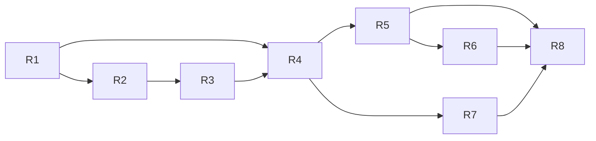

# Implementation Roadmap

Based on the verified state in [PROJECT_AUDIT.md](PROJECT_AUDIT.md). Milestones are ordered by dependency: finish the **minimum viable system (R1–R4)** before the improvements (R5–R8).

Ground rules: small testable changes; never delete datasets, weights, or notebooks; any new download or install is approved first.

---

## R1 — Repository stabilisation and reproducible setup  *(mostly done)*

- **Objective:** one environment, tests green, documented setup.
- **Done:** `.venv` + root `requirements.txt`; fixes for the bridge, device choice, model vocabulary, speech flood, and session control (audit §5).
- **Remaining tasks:**
  1. Run the hardware smoke test (see *Immediate next step*).
  2. Commit the repairs on a branch.
- **Acceptance:** both test suites pass in `.venv`; `torch.cuda.is_available()` is `True`; manual smoke test passes.

## R2 — Honest detector baseline and default-model decision

- **Objective:** decide between the stock 80-class `yolov8n.pt` and the fine-tuned 15-class model using a clean test set.
- **Tasks:**
  1. Download COCO val2017 images (~1 GB; approval required).
  2. Write `module-2/evaluate_baseline.py`: both models, the same 15 classes, val2017 only, reporting mAP50 / mAP50-95 per class and FPS on the RTX 3050.
  3. Record results in `module-2/results_summary.txt` (or a new file) and `research/`.
  4. Set the default `YOLO_MODEL_PATH` accordingly.
- **Prerequisites:** R1.
- **Acceptance:** a table of both models on val2017 + FPS; a written decision.
- **Risk:** the fine-tuned model may not beat the stock one. In that case, keep the 80-class model, since its larger vocabulary is worth more.

## R3 — Open-vocabulary fallback (watch, keys, slippers…)

- **Objective:** handle requests outside the closed-set vocabulary instead of rejecting them.
- **Approach (recommended):** a hybrid. If the target is in the YOLO model's classes, use it; otherwise use **YOLO-World v2** or **YOLOE** through the installed Ultralytics package, calling `set_classes([target])`.
- **Tasks:**
  1. Download one open-vocab checkpoint (~25–50 MB, approval).
  2. Add `OpenVocabDetector` with the same `detect(frame)` output format (`module-3/detection/`).
  3. Detector selection in `main.py` / `assistant.py`, with the model loaded once.
  4. Build a small self-recorded test set (e.g. 20 photos each of watch / keys / slippers / glasses) and measure precision/recall and FPS.
- **Acceptance:** "watch" yields guidance on the test set with stated accuracy; ≥ 10 FPS on GPU.
- **Risks:** small objects (keys) are hard at 640 px. Mitigate by suggesting the user move closer and using a lower threshold plus N-of-M confirmation (R5).
- **Alternatives:** Grounding DINO / OWLv2 (more accurate on phrases, but a few FPS and a heavy `transformers` dependency).

## R4 — End-to-end integrated run

- **Objective:** a verified voice → find → guide → stop session.
- **Tasks:**
  1. Run `assistant.py` with real hardware for 5 scripted scenarios.
  2. Log per-stage latency (record, STT, parse, first detection, first guidance).
  3. Handle a "no target heard" retry (currently it falls back to typing).
- **Acceptance:** 5/5 scenarios complete without a crash; latency table recorded.

## R5 — Temporal stability and guidance UX

- **Tasks:** N-of-M frame confirmation before announcing "found"; smooth the bbox centre over time; a "not seen yet, keep turning slowly" cadence; with several matches, prefer the nearest/largest or use parser attributes (R6).
- **Files:** `navigation/navigation_controller.py`, new `matching/temporal_filter.py`.
- **Acceptance:** unit tests with noisy detection sequences; no guidance flip-flopping in manual testing.

## R6 — Attribute-aware target selection (lightweight referring expressions)

- **Tasks:** use the parser's `attributes`: position (left/right) picks the leftmost/rightmost candidate; color uses an HSV histogram of the bbox crop. Evaluate on RefCOCO testA/testB (restricted to objects in the vocabulary) as accuracy@IoU 0.5.
- **Acceptance:** measured improvement over "highest confidence" on the RefCOCO subset.
- **Note:** full grounding models are optional future work.

## R7 — Distance and accessibility testing

- **Distance:** keep relative cues. Optionally estimate "about N metres" using a pinhole model (`distance ≈ focal_px × real_height / bbox_height_px`) with per-class typical sizes; this needs a one-time focal-length calibration. Metric depth needs a depth or stereo camera.
- **Accessibility protocol:** scripted rooms, time-to-find, success rate, and user feedback on speech cadence; test with a phone or chest-mounted camera facing forward.
- **Offline STT fallback:** wire the existing faster-whisper code for when Sarvam or the network is unavailable.

## R8 — Documentation, demo, academic deliverables

- Update `research/` with the R2–R7 results; a demo script and video; limitations stated honestly (no navigation guarantees, heuristic distance).

---

## Dependency graph

## Immediate next step — hardware smoke test (≈10 minutes)

1. Open PowerShell in `D:\NLP-Research\module-3`.
2. Run `..\.venv\Scripts\python main.py --target bottle --navigate`
3. **Expect:**
   - The console shows `Device : cuda`.
   - A video window opens.
   - With no bottle in view you hear "Bottle not found. Pan camera slowly." about every 3.5 s.
   - Show a bottle and you hear left/right/straight guidance.
   - Bring it close (filling about a quarter of the frame) and you hear "…directly in front of you" once, and the window closes.
4. Run it again and press **ENTER** in the terminal. You should hear "Search cancelled." and the program exits.
5. Run `..\.venv\Scripts\python assistant.py`, say "where is my bottle", and check that the transcript and the extracted target `bottle` are printed (needs `SARVAM_API_KEY` in `module-1\.env` and internet).
6. **If something differs:**
   - Camera error: try `--camera 1`.
   - No sound: try `--no-tts` to confirm the guidance logic, then check Windows speech voices.
   - Voice import warning: run `..\.venv\Scripts\python -c "import pipeline.m3_pipeline as m; print(m.MODULE1_AVAILABLE)"` and share the output.
