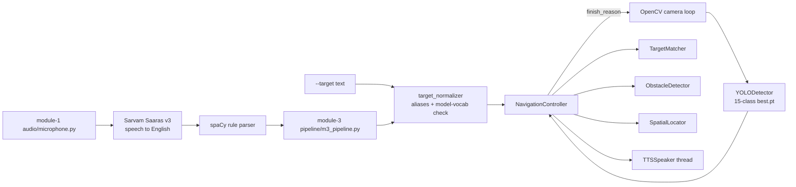

# Project Audit — Assistive Object-Finding System

*Audit date: 2026-10-20. Covers the repository at commit `3fb09d9` plus the repairs listed in §5.*

Evidence labels: **[V]** verified by running code/tests in this audit · **[M]** verified by the user in a manual hardware test · **[R]** verified by reading code/files · **[I]** inference (stated reasoning, not directly tested).

---

## 1. Purpose

Help a visually impaired user find everyday objects: they say what they are looking for (any of the languages Sarvam supports), the system finds it with a camera and speaks directional guidance until the object is in reach, the user cancels, or a timeout occurs.

## 2. Repository structure

| Path | Role | Environment |
|---|---|---|
| `module-1/` | Voice: mic capture → Sarvam Saaras v3 (speech → English) → spaCy rule parser (intent / object / attributes). ASR benchmark in `evaluation/`. | `module-1/venv` (voice deps only) |
| `module-2/` | Data: COCO 2014 + RefCOCO inspection, preprocessing, EDA (notebooks 01–03); `train.py` fine-tunes YOLOv8n on 15 indoor classes. | trained with global Python 3.13 (CUDA torch) |
| `module-3/` | Vision + guidance: camera loop, `YOLODetector`, target normaliser/matcher, 5-zone `SpatialLocator`, `ObstacleDetector`, `NavigationController`, pyttsx3 `TTSSpeaker`, Module-1 bridge. Entry points `main.py`, `assistant.py`. | `module-3/venv` (CPU torch) |
| `research/` | Stage-1 findings, paper draft, figures, tables. | — |
| `.venv/`, `requirements.txt` | **New:** unified environment (voice + vision, CUDA torch). | — |
| Local only (gitignored) | `module-2/datasets/` (COCO train2014 images, train/val2014 annotations, RefCOCO), `module-2/outputs/` (processed CSVs, EDA), `module-2/yolo_dataset/`, `module-2/runs/train/weights/best.pt`, `weights/yolo26n.pt` (unused), `module-1/.env` (never committed — git history checked). | — |

## 3. Architecture and data flow

Interfaces:
- Detection: `{"class_name", "class_id", "confidence", "bbox": [x1, y1, x2, y2]}` (pixels).
- Module 1 result: `{"text", "language", "intent", "object", "attributes", "keywords"}`. The bridge turns this into `{"target", "language", "raw_text", "attributes", "keywords"}`.
- The model is loaded once per session, and a single camera loop and a single speech thread are used.

## 4. Component status (after repairs)

| Component | Status | Evidence |
|---|---|---|
| Module 1 unit tests | Implemented and verified | [V] 77/77 pass |
| Module 3 unit tests | Implemented and verified | [V] 152/152 pass in `.venv` |
| Sarvam STT + translation | Implemented and verified (manual) | [M] English and Hindi requests extracted the correct target; 10-utterance benchmark: 2.0% WER |
| Query parser | Implemented, simple English only | [R] rule-based; picks one object noun; attributes (color / size / position) extracted but not yet used downstream |
| Voice → vision bridge | **Repaired**, verified at import level | [V] previously `MODULE1_AVAILABLE=False` (package-name clash); now `True` when Module 1 packages are present |
| Inference device | **Repaired** | [V] previously defaulted to `cuda` and crashed with CPU-only torch; now automatic |
| Fine-tuned 15-class YOLOv8n | Trained; validation partially trustworthy | [V] `runs/train/results.csv`, epoch 30: P 0.567, R 0.467, mAP50 0.481, mAP50-95 0.331. See leakage caveat §6. |
| Detector on a real image | Verified (no camera) | [V] COCO image → cup ×2, bottle ×2; "bottle" → "Bottle is on your right. Turn slightly right." |
| Supported-target check | **Repaired** | [V] now uses the loaded model's classes ("clock" is unsupported with the 15-class model) |
| Speech flood | **Repaired** | [V] persistent hazard used to queue 60 utterances in 60 frames; now ≤ 1 |
| Session end (arrival / timeout / cancel / unsupported) | Implemented and verified | [V] unit tests + [M] hardware run |
| Spatial zones | Implemented and verified (unit tests) | [R] 5 zones from the bbox centre x (20/40/60/80% boundaries) |
| Distance | Heuristic only | [R] "reached" = bbox ≥ 22% of the frame area, with the same threshold for every class; no metric distance |
| Obstacle detection | Implemented, unit-tested | [R] class list includes `bench`, `refrigerator`, `toilet`, which the 15-class model cannot detect |
| Unsupported objects (watch, keys, slippers) | Not implemented | [R] rejected with a spoken message |
| RefCOCO grounding | Not implemented | [R] data used for EDA only |
| Camera / mic / speakers end-to-end | Implemented and verified (manual, desk setup) | [M] 14-check manual test, all passed (§7b) |

## 5. Repairs made in this audit

| # | Problem (impact) | Fix | Files | Verification |
|---|---|---|---|---|
| 1 | No single environment had both voice and vision packages, so the integrated assistant could not run | Root `requirements.txt` + `.venv` with CUDA torch | `requirements.txt`, `README.md` | §7 |
| 2 | Both modules have a `pipeline` package, so the Module 1 import always failed and voice mode was silently unavailable | Load `module-1/pipeline/hearing_pipeline.py` by file path under a unique name | `module-3/pipeline/m3_pipeline.py` | [V] import check; `tests/test_m3_pipeline_bridge.py` |
| 3 | Default device `cuda` + CPU-only torch caused a crash on model load | Default is `cuda` only if `torch.cuda.is_available()` | `module-3/config/config.py` | [V] detector loads; config test |
| 4 | Support check used COCO-80, but the model knows 15 classes, so some targets would be searched for forever | `is_supported_class(target, class_names)`; `TargetMatcher(supported_classes=…)`; entry points check after the model loads | `matching/*.py`, `main.py`, `assistant.py`, `detection/camera_detector.py` | [V] 6 new tests |
| 5 | Emergency / arrival speech forced every frame, so stale audio piled up | Identical text repeats only after the cooldown (all priorities); newer messages replace stale pending ones of equal or lower priority; controller no longer forces per-frame messages | `audio_feedback/tts_speaker.py`, `navigation/navigation_controller.py` | [V] 4 new tests |
| 6 | Search only ended with Q in the video window; arrival did not end it; no timeout; a dead camera looped forever | Arrival confirmed over N frames ends the session; 60 s no-sighting timeout (not blocked by obstacles); ENTER-in-terminal cancel; stop after 50 failed reads | `navigation/navigation_controller.py`, `detection/camera_detector.py`, `config/config.py` | [V] 7 new tests incl. fake-camera loop |
| 7 | `assistant.py --camera` was ignored; `train.py` used `shutil` without importing it; `train.py --resume` wrote "validation not run" | Pass `camera_index`; add import; validate `best.pt` after resume | `assistant.py`, `module-2/train.py` | [V] parse/import check (training not re-run) |

Not changed (by design): model weights, datasets, notebooks, research outputs, `results_summary.txt` (still shows the resume-overwritten text; the real metrics are in `runs/train/results.csv`).

## 6. Dataset and model findings

- **Datasets present:** COCO 2014 *train* images (82,783) with train + val annotations; RefCOCO (`instances.json`, `refs(unc).p`, `refs(google).p`). COCO val2014 *images* are **not** downloaded.
- **Processed outputs:** `coco_processed.csv` (604,906 annotations, 1 zero-height box removed) and `refcoco_processed.csv` (267,568 expressions after removing 16,852 duplicates). Notebook outputs report 0 referential-integrity mismatches. [R]
- **Dataset "merging":** RefCOCO was joined to COCO boxes for EDA. There's no merged training set, and nothing trains on RefCOCO.
- **Training split:** an image-level 80/20 split of train2014 (seed 42); val capped at 3,000 images. [R]
- **Leakage caveat [I, high confidence]:** the base `yolov8n.pt` was pretrained on COCO train2017, which includes almost all train2014 images. The 3,000 "val" images were therefore seen during pretraining, so mAP50 = 0.481 is optimistic. There is no baseline comparison with stock `yolov8n.pt` on the same 15 classes. The only clean held-out COCO images are val2017 (a subset of val2014).
- **Vocabulary trade-off:** fine-tuning to 15 classes removes 65 COCO classes, several of them useful here (remote, clock, scissors, handbag, keyboard, mouse, toothbrush).
- **Detection vs. grounding:** a detector returns every instance of a fixed set of classes. Grounding locates the specific object described by free text ("the black bottle near the laptop"). Combining COCO and RefCOCO data does not create a grounding model; grounding needs a text-conditioned architecture.
- **Out-of-vocabulary objects** (watch, keys, slippers, glasses, pen) cannot be detected by either YOLO model.

## 7. Verification log

| Check | Result |
|---|---|
| `module-1`: `pytest tests -q` (module-1/venv) | 77 passed |
| `module-3`: `pytest tests -q` (module-3/venv) | 150 passed, 1 skipped |
| Bridge import with Module 1 packages present | `MODULE1_AVAILABLE = True` |
| Detector + navigation on a COCO image (CPU) | correct guidance / unsupported message |
| `.venv`: torch 2.11.0+cu128, `torch.cuda.is_available()` | `True` (RTX 3050 6GB Laptop GPU) |
| `.venv`: module-1 suite / module-3 suite | 77 passed / **151 passed, 0 skipped** |
| `.venv`: bridge import | `MODULE1_AVAILABLE = True` |
| `.venv`: fine-tuned model inference on GPU (640 px, single image, 50 runs) | 8.8 ms/frame (≈113 FPS model-only; camera + drawing not included) |

## 7b. Manual hardware test (user-run, 2026-10-20)

Setup: Windows laptop, RTX 3050, built-in webcam (index 0), Bluetooth headset mic/output, root `.venv`, commit `dd01459`.

| # | Check | Result |
|---|---|---|
| 1 | Environment + CUDA | Pass |
| 2 | Module 1 tests (77) | Pass |
| 3 | Module 3 tests (152) | Pass |
| 4 | Live camera + YOLO detection | Pass |
| 5 | Typed target matching (found / not found) | Pass |
| 6 | Direction guidance (left / centre / right) | Pass |
| 7 | Arrival stop | Pass |
| 8 | ENTER cancellation | Pass |
| 9 | 15 s timeout | Pass |
| 10 | Unsupported targets (watch, clock) | Pass |
| 11 | Obstacle warnings without queue flooding | Pass |
| 12 | English voice → target → guidance | Pass |
| 13 | Hindi voice → correct target | Pass |
| 14 | Failure handling (silence, unclear speech, unsupported request) | Pass |

Scope: a functional pass/fail check by one tester. It is not a usability study or an accuracy benchmark.

## 8. Remaining limitations and open issues

1. Hardware testing so far is a single user at a desk with a laptop webcam. There is no forward-facing-camera or multi-room test yet, and no success-rate or time-to-find measurements (roadmap R7).
2. No detection for objects outside the model's classes (watch, keys, slippers).
3. Parser attributes (color / position) are ignored, so with several bottles the system picks the highest-confidence one.
4. Left/right is image-space and is correct only if the camera faces the same way as the user. "Reached" is a class-agnostic area heuristic.
5. No temporal smoothing: one noisy frame can switch guidance.
6. pyttsx3 calls `runAndWait()` in a worker thread. This works with Windows SAPI5, but a long utterance cannot be interrupted by an emergency message.
7. Speech recognition needs internet (Sarvam). An offline fallback (faster-whisper) exists for evaluation but is not wired into the app.
8. `ObstacleDetector` lists classes (bench, refrigerator, toilet) that the 15-class model never outputs.
9. Absolute paths in generated files (`module-2/dataset.yaml`, `runs/train/args.yaml`, `run_training.bat`) tie training to `D:\NLP-Research`.
