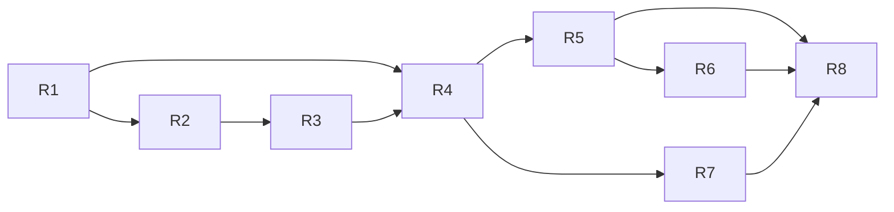

# Implementation Roadmap

Based on the verified state in [PROJECT_AUDIT.md](../PROJECT_AUDIT.md). Milestones are ordered by dependency: finish the **minimum viable system (R1–R4)** before the improvements (R5–R8).

Ground rules: small testable changes; never delete datasets, weights, or notebooks; any new download or install is approved first.

---

## R1 — Repository stabilisation and reproducible setup  *(mostly done)*

- **Objective:** one environment, tests green, documented setup.
- **Done:** `.venv` + root `requirements.txt`; fixes for the bridge, device choice, model vocabulary, speech flood, and session control (audit §5).
- **Remaining tasks:**
  1. Run the hardware smoke test (see *Immediate next step*).
  2. Commit the repairs on a branch.
- **Acceptance:** both test suites pass in `.venv`; `torch.cuda.is_available()` is `True`; manual smoke test passes.

## R2 — Honest detector baseline and default-model decision

- **Objective:** decide between the stock 80-class `yolov8n.pt` and the fine-tuned 15-class model using a clean test set.
- **Why now:** desk trials (audit §7c) show the main remaining failure is a bottle with a face or person directly behind it (15–77% of frames). The COCO analysis showed the stock model holds up better with a person present (bottle recall 47% vs 40% at 0.40).
- **Tasks:**
  0. ~~Quick desk check with stock `yolov8n.pt`~~ **Done (audit §7c):** stock was worse in both face scenes (6.7% vs 15.3% and 53.9% vs 76.9% raw @0.25). The fine-tuned model stays the default. The remaining tasks below are now about the paper (clean val2017 numbers), not about the app.
  1. Download COCO val2017 images (~1 GB; approval required).
  2. Write `module2_vision/training/evaluate_baseline.py`: both models, the same 15 classes, val2017 only, reporting mAP50 / mAP50-95 per class and FPS on the RTX 3050.
  3. Record results in a new dated experiment in `research/experiments/`.
  4. Set the default `YOLO_MODEL_PATH` accordingly.
- **Prerequisites:** R1.
- **Acceptance:** a table of both models on val2017 + FPS; a written decision.
- **Risk:** the fine-tuned model may not beat the stock one. In that case, keep the 80-class model, since its larger vocabulary is worth more.

## R3 — Open-vocabulary fallback (watch, keys, slippers…)

- **Objective:** handle requests outside the closed-set vocabulary instead of rejecting them.
- **Approach (recommended):** a hybrid. If the target is in the YOLO model's classes, use it; otherwise use **YOLO-World v2** or **YOLOE** through the installed Ultralytics package, calling `set_classes([target])`.
- **Tasks:**
  1. Download one open-vocab checkpoint (~25–50 MB, approval).
  2. Add `OpenVocabDetector` with the same `detect(frame)` output format (`module2_vision/detection/`).
  3. Detector selection in `main.py` / `assistant.py`, with the model loaded once.
  4. Build a small self-recorded test set (e.g. 20 photos each of watch / keys / slippers / glasses) and measure precision/recall and FPS.
- **Progress (2026-10-23, EXP-06):**
  - ✅ Task 1: weights downloaded and verified (`module2_vision/weights/`). The `clip` package was installed.
  - ✅ Task 2: `module2_vision/detection/open_vocab_detector.py` (prompt-free YOLOE, text-prompt YOLOE, YOLO-World).
  - ✅ Speed: every candidate ≥ 30 FPS model-only (YOLO-World 12 ms, YOLOE-26s 17–22 ms, YOLOE-26n-pf 31–33 ms).
  - ✅ Task 4: desk accuracy (EXP-06 Part B): worn watch 99.7 %, slippers 99.7 %, keys 0 %, absent scenes 0 % false sightings.
  - ✅ Task 3: YOLOE-26s text prompt chosen (D-13); `detection/detector_factory.py` used by `main.py` and `assistant.py`; aliases added.
  - ⏳ Live app check by the user (`main.py --target watch --navigate`).
  - ✅ Prompt wording (EXP-07): "watch" is already the best watch prompt; "bunch of keys" finds keys on a table (99.7 % vs 0 %). Prompt map active (D-14, `OPEN_VOCAB_PROMPTS`).
  - **Open:** objects held in the hand (0 % for watch and keys with every prompt); a 0.10 open-vocabulary threshold for objects lying flat, after more absent/cluttered scenes (with a person in view) for false positives.
- **Acceptance:** "watch" yields guidance on the test set with stated accuracy; ≥ 10 FPS on GPU.
- **Risks:** small objects (keys) are hard at 640 px. Mitigate by suggesting the user move closer and using a lower threshold plus N-of-M confirmation (R5).
- **Alternatives:** Grounding DINO / OWLv2 (more accurate on phrases, but a few FPS and a heavy `transformers` dependency).

## R4 — End-to-end integrated run

- **Objective:** a verified voice → find → guide → stop session.
- **Tasks:**
  1. Run `assistant.py` with real hardware for 5 scripted scenarios.
  2. Log per-stage latency (record, STT, parse, first detection, first guidance).
  3. Handle a "no target heard" retry (currently it falls back to typing).
- **Acceptance:** 5/5 scenarios complete without a crash; latency table recorded.

## R5 — Temporal stability and guidance UX

- **Done:**
  - 2-of-5 frame confirmation and a 0.5 s hold (`matching/temporal_filter.py`).
  - Requested class accepted from 0.25.
  - Speech cadence: new direction after 1.2 s, identical message after 4 s, short phrases.
  - Desk trials: lost events went 22 → 0 (bottle at 2 m) and 9 → 0 (person behind).
- **Remaining:**
  - Smooth the bbox centre so zone changes don't jitter at zone borders.
  - With several matches, prefer the nearest or largest, or use parser attributes (R6).
  - Interruptible speech for emergencies.
- **Acceptance:** unit tests with noisy detection sequences; no guidance flip-flopping in manual testing.

## R6 — Attribute-aware target selection (lightweight referring expressions)

- **Tasks:** use the parser's `attributes`: position (left/right) picks the leftmost/rightmost candidate; color uses an HSV histogram of the bbox crop. Evaluate on RefCOCO testA/testB (restricted to objects in the vocabulary) as accuracy@IoU 0.5.
- **Acceptance:** measured improvement over "highest confidence" on the RefCOCO subset.
- **Note:** full grounding models are optional future work.

## R7 — Distance and accessibility testing

- **Distance:** keep relative cues. Optionally estimate "about N metres" using a pinhole model (`distance ≈ focal_px × real_height / bbox_height_px`) with per-class typical sizes; this needs a one-time focal-length calibration. Metric depth needs a depth or stereo camera.
- **Accessibility protocol:** scripted rooms, time-to-find, success rate, and user feedback on speech cadence; test with a phone or chest-mounted camera facing forward.
- **Offline STT fallback:** ~~wire the existing faster-whisper code~~. Superseded by R9: offline is now the default, not a fallback.

## R9 — Fully offline and multilingual (USP; started 2026-10-23, branch `feature/offline-multilingual`)

- **Objective:** every session runs on the laptop without internet, in the user's language. The paper reports the laptop prototype; a phone/glasses product is future work (D-16).
- **Done (2026-10-23):**
  - Offline mode and pre-flight `tools/offline_check.py` (D-16).
  - On-device Whisper as the default recogniser; Sarvam opt-in (D-15).
  - EXP-08 tooling: `record_multilingual.py`, `multilingual_benchmark.py`, 20-request prompt sheet.
  - Phrase table and voice-by-language replies (D-17).
  - Per-stage session latency log.
  - EXP-10 partial (CPU speed).
- **Remaining, in order:**
  1. ~~**Approval:** download Whisper `small`, `medium`, `large-v3`~~ Done 2026-10-25/27.
  2. ~~**User:** record the test set~~ Done 2026-10-27: Hindi + English (D-18), 3 speakers, quiet only (D-19).
  3. ~~Run EXP-08~~ Done 2026-10-27 (run 1, incl. Sarvam); D-15 decided: large-v3 + language hint.
  4. ~~Optional~~ Not pursued: Whisper large-v3/medium reach 90 % in Hindi. Optional, if Whisper is weak on Indic languages: IndicConformer-600M + IndicTrans2-200M behind the same interface (install approval; gated model).
  5. ~~Native-speaker review of the Hindi phrases~~ Done 2026-10-27 (accepted unchanged). Install a Windows Hindi voice (approval). Add tables for further languages.
  6. **EXP-09:** `offline_check.py`, then network off, then `assistant.py --scenario <name>`: 5 scenarios × ≥ 2 languages, laptop webcam and a forward-facing USB camera. Rows land in `tools/results/session_latency_<date>.csv`.
  7. **EXP-10 completion:** ~~large Whisper models on CPU~~ (done 2026-10-27: large-v3 7.5 s, small 1.2 s per request); optional ONNX/INT8 export (`onnx`/`onnxruntime` install approval).
- **Acceptance:**
  - C19: a full session with the network off.
  - EXP-08 table: object accuracy per language for each backend vs Sarvam.
  - EXP-10 table.

## R8 — Documentation, demo, academic deliverables

- Update `research/` with the R2–R7 results; a demo script and video; limitations stated honestly (no navigation guarantees, heuristic distance).

---

## Dependency graph

## Immediate next step — hardware smoke test (≈10 minutes)

1. Open PowerShell in `D:\NLP-Research\module2_vision`.
2. Run `..\.venv\Scripts\python main.py --target bottle --navigate`
3. **Expect:**
   - The console shows `Device : cuda`.
   - A video window opens.
   - With no bottle in view you hear "Bottle not seen. Turn slowly." about every 4 s.
   - Show a bottle and you hear left/right/straight guidance.
   - Bring it close (filling about a quarter of the frame) and you hear "…directly in front of you" once, and the window closes.
4. Run it again and press **ENTER** in the terminal. You should hear "Search cancelled." and the program exits.
5. Run `..\.venv\Scripts\python assistant.py`, say "where is my bottle", and check that the transcript and the extracted target `bottle` are printed (needs `SARVAM_API_KEY` in the root `.env` and internet).
6. **If something differs:**
   - Camera error: try `--camera 1`.
   - No sound: try `--no-tts` to confirm the guidance logic, then check Windows speech voices.
   - Voice import warning: run `..\.venv\Scripts\python -c "import pipeline.m3_pipeline as m; print(m.MODULE1_AVAILABLE)"` and share the output.
